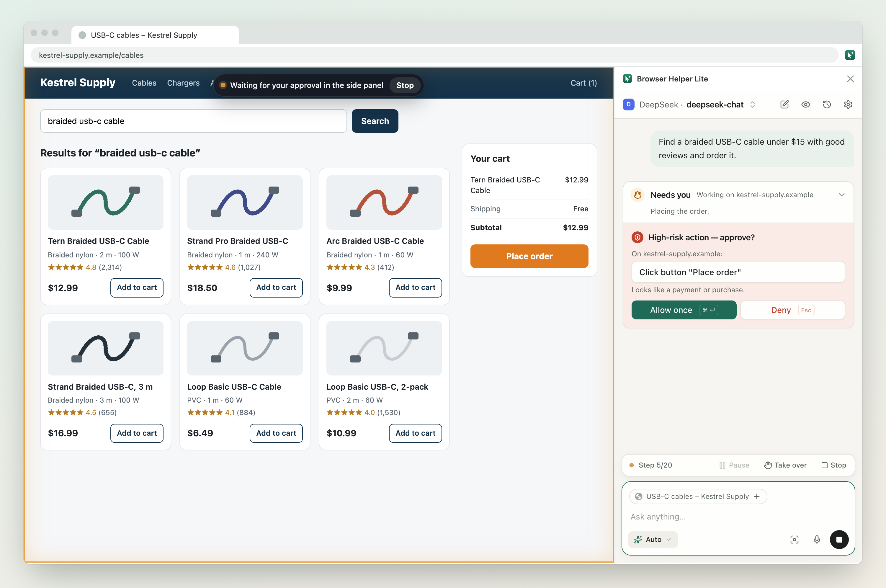
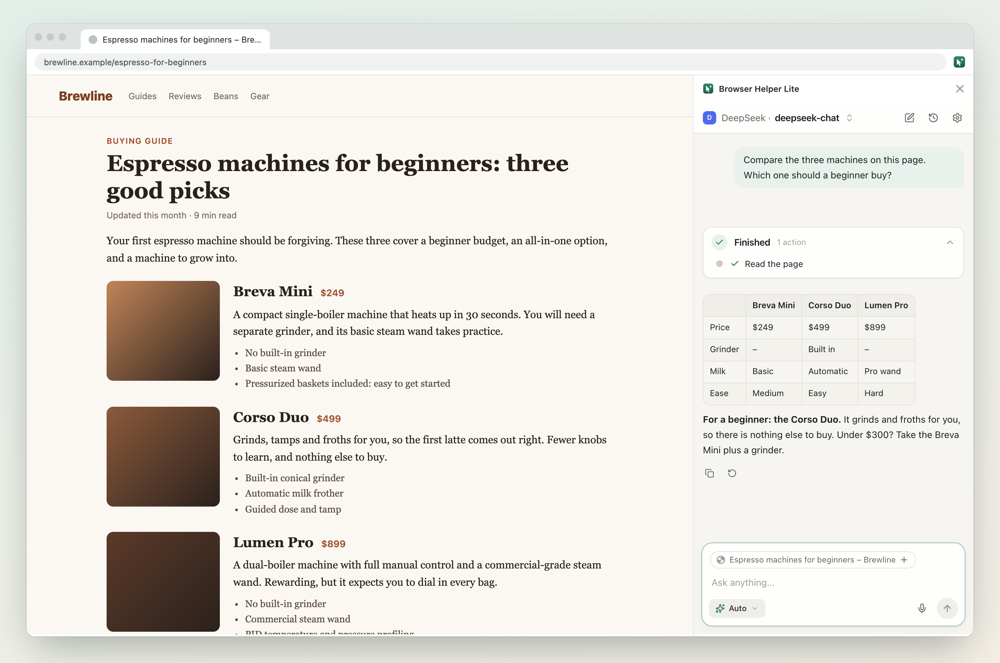
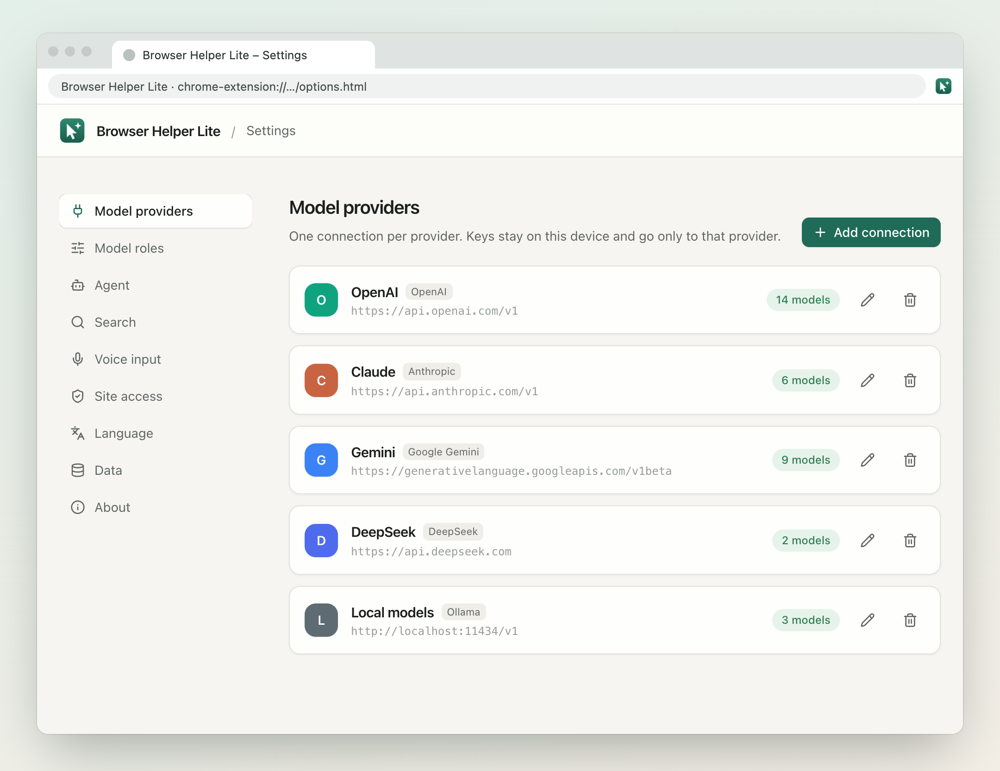

# Browser Helper Lite

English | [简体中文](README.zh-CN.md)

An AI assistant in Chrome's side panel that works with the model and API key of your choice. It answers questions about the page you are on and, on sites you allow, clicks, types and navigates for you, asking first before anything risky.



## Features

- **Any model, your own key**: OpenAI, Anthropic, Google Gemini, DeepSeek, and any OpenAI-compatible API (Qwen, Kimi, GLM, Doubao, OpenRouter, Groq, Ollama, LM Studio and more).
- **Chat about pages**: summaries and comparisons of the page you are on, other tabs with `@`, Markdown with code, math and Mermaid diagrams. Mark a part of the page to ask about it. Speak your question and have the reply read aloud.
- **Shopping**: on a product page, one click compares prices at other stores by what you would pay delivered, sums up the reviews (also the low-rated ones past the first page), finds what testers and owners say on forums and social media, lists what to watch out for, or checks whether a discount is real. Offers come with the product's picture and a link. It never places an order.
- **Skills**: how the assistant goes about a kind of work, and what its answer looks like, is a skill: a page of instructions it loads when the work comes up. The shopping skills are built in. Write your own or install one from a file or an address under Settings › Skills, and use it by its name after a slash.
- **Research**: reads a dozen sources side by side and compares them in a table you can sort and export as CSV.
- **Watches pages for you**: "tell me when this drops below $20". It looks at the page again as often as you choose (every five minutes by default, down to every second), in the background, and notifies you. It only reads, you confirm each watch, and your model is asked only when what it watches on the page changes.
- **Acts on websites**: searches, clicks, types, scrolls and opens tabs to finish a task, and hands CAPTCHAs and logins back to you.
- **Sees what text misses**: on canvas apps, maps and buttons without labels it looks at a screenshot, with your current model if it reads images or with a separate vision model, and can click by position. You approve clicks on content it cannot read, with a picture of where they land.
- **Replay and repeat**: watch a finished task again picture by picture, with a ring where it clicked, and save it as a command to run again by name.
- **You stay in control**: three modes, Query (read only), Auto (asks before payments, deletions and other high-risk steps) and Manual approval (asks before every change), plus per-site rules. Pause, stop or take over at any time.
- **Quick to reach**: open the panel with <kbd>Alt</kbd>+<kbd>Shift</kbd>+<kbd>H</kbd>, or right-click a page to summarize it or ask about the selected text.
- **Defends against prompt injection**: hidden page text never reaches the model, page content cannot pass as instructions, and links that would carry your data out need your approval. See [docs/security](docs/security/README.md).
- **No server of its own**: conversations stay in your browser, and requests go straight to the provider you configure. Export (encrypted with a password), import or erase everything under Settings › Data.

The interface is available in English, 简体中文, Français and Español.

| Ask about the page you are reading | Connect the providers you use |
| --- | --- |
|  |  |

## Install

Requires Chrome 116 or later.

Run one command. It downloads the latest release, checks it against the SHA-256 that GitHub lists for it, unpacks it to `~/browser-helper-lite-extension`, copies that path and opens `chrome://extensions`.

macOS and Linux:

```bash
curl -fsSL https://raw.githubusercontent.com/ethanzhrepo/browser-helper-lite/main/scripts/install.sh | sh
```

Windows (PowerShell):

```powershell
irm https://raw.githubusercontent.com/ethanzhrepo/browser-helper-lite/main/scripts/install.ps1 | iex
```

Then finish in Chrome, which installs extensions by itself only from the Chrome Web Store:

1. On `chrome://extensions`, turn on **Developer mode** (top right).
2. Click **Load unpacked** and choose the folder. Its path is on your clipboard: paste it into the dialog (on macOS press <kbd>Cmd</kbd>+<kbd>Shift</kbd>+<kbd>G</kbd> first).
3. Click the toolbar icon to open the side panel, then add a model connection in Settings.

**Update**: run the same command again, then click the reload button on the extension's card in `chrome://extensions`. Chrome does not update an unpacked extension by itself, so the extension tells you when a newer release is out. The folder stays the same, so your settings, keys and conversations stay too.

**Uninstall**: remove the extension in `chrome://extensions`, then delete the folder.

Set `BHL_DIR` to use another folder, or `BHL_VERSION` to install a specific release. You can read [install.sh](scripts/install.sh) and [install.ps1](scripts/install.ps1) before running them.

<details>
<summary>Install by hand</summary>

1. Download `browser-helper-lite-<version>-chrome.zip` from [Releases](https://github.com/ethanzhrepo/browser-helper-lite/releases) and unzip it.
2. Open `chrome://extensions`, turn on **Developer mode**, click **Load unpacked** and choose the unzipped folder.
3. Click the toolbar icon to open the side panel, then add a model connection in Settings.

</details>

While the assistant acts on a page, Chrome shows a "started debugging this browser" bar: the extension uses Chrome's debugger API to send real mouse and keyboard input. To build without the `debugger` permission, run `pnpm build:no-cdp`; the assistant then simulates page events instead.

## Development

Requires Node.js 20+ and pnpm.

```bash
pnpm install
pnpm dev           # opens Chrome with the extension loaded
pnpm build         # builds into .output/chrome-mv3
pnpm zip           # packs the release zip
pnpm compile       # type check
pnpm test          # unit tests
pnpm test:e2e      # end-to-end tests in Chromium against a mock model server
pnpm screenshots   # regenerates the screenshots in this README
```

Before the first end-to-end run, install Playwright's browser with `pnpm exec playwright install chromium`, or point `CHROMIUM_PATH` at Chromium 141 or later.

The design notes ([docs/product-design.md](docs/product-design.md)) and security records are in Chinese.

## Privacy

Conversations are stored locally in the browser. Requests go directly from the extension to your model provider. API keys stay in the extension's storage and are never exposed to web pages. Requests to OpenAI set `store: false`. Screenshots the assistant looks at go to the model that reads them, and are not taken by themselves on sign-in, account or payment pages. Deleting a conversation erases its messages and the pages attached to them.

A web search sends the query to the search provider you choose. With DeepSeek search, public pages the assistant only needs to read are fetched by DeepSeek instead of opened in a tab, so their addresses go to DeepSeek (turn it off under Settings › Search). You can also send the first 128 characters of your message with each search for better results; that is off unless you turn it on. A watched page is opened in a background tab and its text goes to your model, like any page the assistant reads, when the watch starts and whenever the part of the page it depends on changes; a watch faster than once a minute keeps its page open in a collapsed tab group and reloads it every 30 seconds at most. You can rush a watch for ten minutes (a reload every five seconds); a site that answers with a CAPTCHA is left alone for a while, and you are told. Watches end after 30 days and are listed in the panel. Pictures kept for the replay, and parts of pages you mark, are stored in the browser with their conversation; the marked parts are sent to the model that reads images. Replies are read aloud by your system's voices, on your device.

A reply can show a product's picture. The panel itself loads nothing from the web: the extension fetches the picture, without cookies and without saying which page it came from, and only from an address that was on a page the assistant read; a small copy is kept with the conversation. The server of the picture sees that request, as it does when you open the product's page. On forums and social media the assistant reads, in the tab, as you would, signed in as you: a request looks at eight pages of such a site at most, and a like, a vote, a follow or a post always asks you first. Which sites these are, and the number of pages, are yours to change under Settings › Site access. A skill you install is text that the assistant follows as if it were yours: read it before you install it. It is fetched without cookies when you give its address, and it cannot turn off approvals.

An export is encrypted with a password of your choice (AES-256-GCM, key from PBKDF2-SHA-256); API keys are exported only in an encrypted file.

Once a day the extension asks GitHub for this project's latest release number, to tell you about updates. The request carries nothing about you; turn it off under Settings › About.

## Security

Please report vulnerabilities privately as described in [SECURITY.md](SECURITY.md).

## License

[Apache License 2.0](LICENSE)
