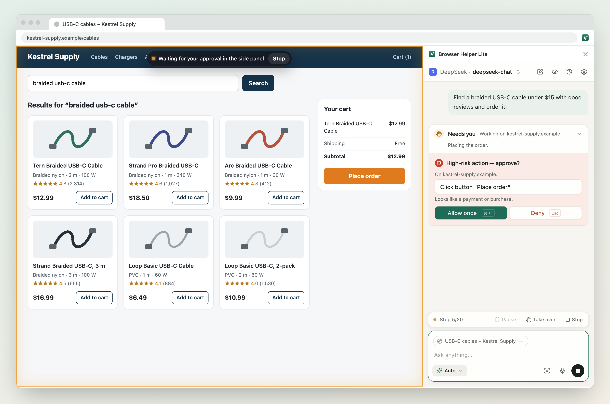
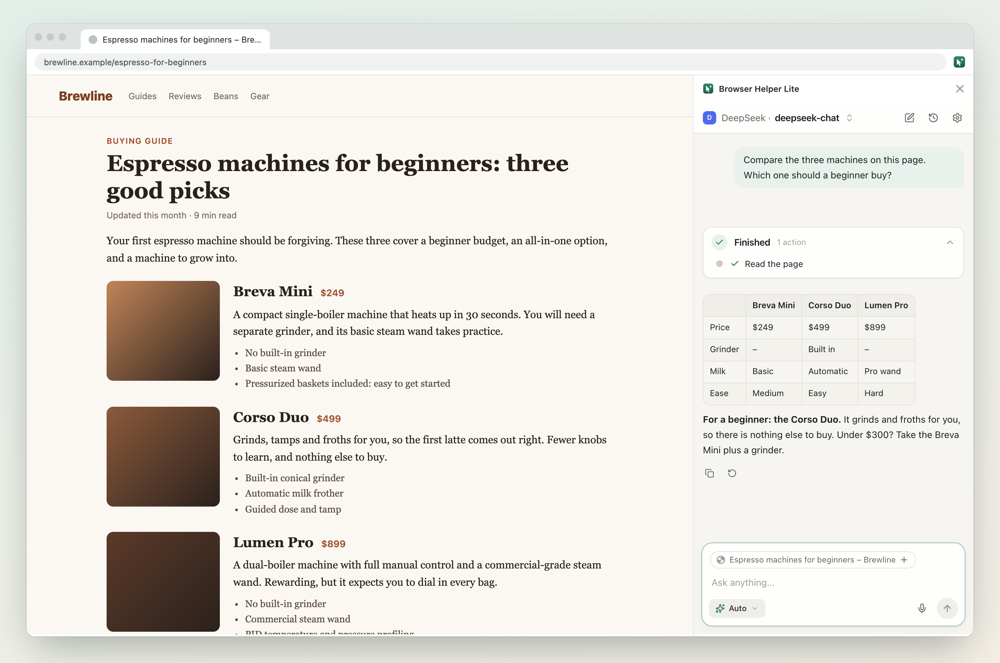
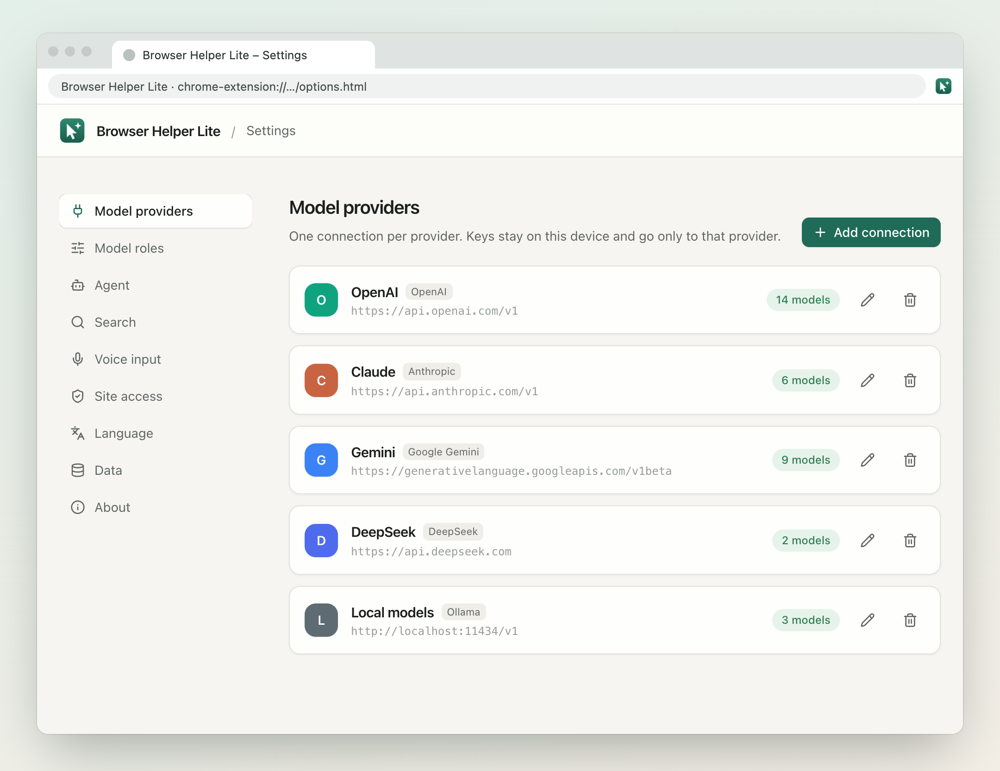

# Browser Helper Lite

[English](README.md) | 简体中文

一个 Chrome 侧边栏 AI 助手，模型和 API Key 都由你自己选。它能回答你在看的网页上的问题，也能在你允许的网站上替你点击、输入、跳转，遇到有风险的操作会先问你。



## 功能

- **任意模型，自带 Key**：OpenAI、Anthropic、Google Gemini、DeepSeek，以及任何 OpenAI 兼容接口（通义千问、Kimi、智谱、豆包、OpenRouter、Groq、Ollama、LM Studio 等）。
- **围绕网页对话**：总结、比较当前页面，用 `@` 带上别的标签页；Markdown 支持代码、公式和 Mermaid 图表。可以框选页面的一部分来提问。可以用语音提问，回复也可以朗读出来。
- **购物**：在商品页上一键比价（按到手价比较其他商家）、总结评价（包括第一页之后的差评）、查专业评测和论坛、社交媒体上的口碑、列出下单前要注意的地方、判断折扣是不是真的。结果带商品图和链接。它不会替你下单。
- **技能**：助手做某一类事的方法和回答的样子写成技能，遵循 [Agent Skills](https://agentskills.io/specification) 格式：一个带 `SKILL.md` 的文件夹，用得上时才加载。购物相关的技能是内置的（`src/skills/builtin/`）；你也可以在「设置 › 技能」里自己写，或从 `SKILL.md`、整个文件夹的 zip、GitHub 上的文件夹安装，然后输入斜杠加名称来用。技能附带的参考文件在说明里提到时才读取；脚本不会安装，扩展不运行任何代码。
- **多页调研**：同时读十来个来源，整理成可以排序、导出 CSV 的对比表。
- **替你盯页面**：「降到 500 以下告诉我」。它按你选的间隔（默认 5 分钟，最短 1 秒）在后台重新查看页面，条件满足时通知你。只读不操作，每一项都要你确认；只有盯着的内容变了才会用到模型。
- **替你操作网站**：搜索、点击、输入、滚动、开标签页来完成任务；遇到验证码和登录时交给你。
- **看得见文字之外的内容**：遇到 canvas 应用、地图、没有文字的按钮时会看截图，当前模型能看图就用它，否则用单独配置的视觉模型，并且可以按位置点击。点击它读不到的内容前要你确认，确认卡上有落点的图。
- **回放和重做**：任务结束后可以逐帧回看，点击的位置有标记；还可以存为指令，下次输入名字重跑。
- **始终由你掌控**：三种模式：查询（只读）、自动（付款、删除等高风险操作前会问你）、手动批准（每个改动都要你确认），还可以按网站设规则。随时可以暂停、停止或自己接手。
- **随手可用**：按 <kbd>Alt</kbd>+<kbd>Shift</kbd>+<kbd>H</kbd> 打开侧边栏；在网页上点右键可以总结此页，或询问选中的文字。
- **防范提示词注入**：网页里的隐藏文字不会交给模型，网页内容冒充不了指令，会把你的数据带出去的链接需要你批准。详见 [安全文档](docs/security/README.md)。
- **没有自己的服务器**：对话保存在你的浏览器里，请求直接发往你配置的模型供应商。在「设置 › 数据」里可以导出（用密码加密）、导入或清除全部数据。

界面支持简体中文、English、Français、Español。

| 问你正在看的页面 | 接入你用的模型供应商 |
| --- | --- |
|  |  |

## 安装

需要 Chrome 116 或更新版本。

运行一条命令即可。它会下载最新版本，用 GitHub 为该文件公布的 SHA-256 校验，解压到 `~/browser-helper-lite-extension`，把这个路径复制到剪贴板，并打开 `chrome://extensions`。

macOS 和 Linux：

```bash
curl -fsSL https://raw.githubusercontent.com/ethanzhrepo/browser-helper-lite/main/scripts/install.sh | sh
```

Windows（PowerShell）：

```powershell
irm https://raw.githubusercontent.com/ethanzhrepo/browser-helper-lite/main/scripts/install.ps1 | iex
```

最后几步要在 Chrome 里完成，因为 Chrome 只会自动安装来自 Chrome 应用商店的扩展：

1. 在 `chrome://extensions` 页面开启右上角的「开发者模式」。
2. 点「加载已解压的扩展程序」，选择上面那个文件夹。路径已经在剪贴板里，粘贴到对话框即可（macOS 先按 <kbd>Cmd</kbd>+<kbd>Shift</kbd>+<kbd>G</kbd>）。
3. 点工具栏图标打开侧边栏，在设置里添加一个模型连接。

**更新**：再运行一次同一条命令，然后在 `chrome://extensions` 里点这个扩展卡片上的刷新按钮。Chrome 不会自动更新已解压的扩展，所以有新版本时扩展会提醒你。文件夹位置不变，所以设置、Key 和对话记录都会保留。

**卸载**：在 `chrome://extensions` 里移除扩展，再删除这个文件夹。

用 `BHL_DIR` 可以换一个文件夹，用 `BHL_VERSION` 可以安装指定版本。运行之前可以先看看 [install.sh](scripts/install.sh) 和 [install.ps1](scripts/install.ps1) 的内容。

<details>
<summary>手动安装</summary>

1. 从 [Releases](https://github.com/ethanzhrepo/browser-helper-lite/releases) 下载 `browser-helper-lite-<版本>-chrome.zip` 并解压。
2. 打开 `chrome://extensions`，开启「开发者模式」，点「加载已解压的扩展程序」，选择解压出来的文件夹。
3. 点工具栏图标打开侧边栏，在设置里添加一个模型连接。

</details>

助手操作网页时，Chrome 会显示「正在调试此浏览器」的提示条：扩展通过 Chrome 的调试接口发送真实的鼠标和键盘输入。想不授予 `debugger` 权限，可以用 `pnpm build:no-cdp` 构建，助手会改用模拟的页面事件。

## 开发

需要 Node.js 20+ 和 pnpm。

```bash
pnpm install
pnpm dev           # 打开一个已加载扩展的 Chrome
pnpm build         # 构建到 .output/chrome-mv3
pnpm zip           # 打包发布用的 zip
pnpm compile       # 类型检查
pnpm test          # 单元测试
pnpm test:e2e      # 端到端测试：在 Chromium 里对着模拟模型服务器跑
pnpm screenshots   # 重新生成 README 里的截图
```

第一次跑端到端测试前，先用 `pnpm exec playwright install chromium` 安装 Playwright 的浏览器，或者用 `CHROMIUM_PATH` 指定 141 或更新版本的 Chromium。

产品设计见 [docs/product-design.md](docs/product-design.md)，安全审计记录见 [docs/security](docs/security/README.md)。

## 隐私

对话保存在浏览器本地。请求直接从扩展发往你的模型供应商。API Key 只存在扩展自己的存储里，不会暴露给任何网页。发往 OpenAI 的请求设置了 `store: false`。助手看的截图会发给负责看图的模型；登录、账户和支付页面不会自动截图。删除对话会一并清除它的消息和附带的页面内容。

联网搜索会把搜索词发给你选的搜索服务。用 DeepSeek 搜索时，助手只需要读的公开网页由 DeepSeek 抓取，不再开标签页，网址会发给 DeepSeek（可在「设置 › 搜索」里关闭）。还可以把你消息的前 128 个字随搜索一并发过去，让结果更贴合；这一项默认关闭。盯着的页面会在后台标签页里打开；开始盯的时候、以及它依据的那部分页面内容变化的时候，页面文字会发给你的模型，和助手读其他页面一样。间隔短于 1 分钟的，页面会一直开在一个收起的标签组里，最快每 30 秒刷新一次。可以对某一项开 10 分钟急速（每 5 秒刷新）；网站弹出验证码时会自动放慢并通知你。每一项最长 30 天，都列在侧边栏里。回放用的截图和你框选的页面截图随对话存在浏览器里；框选的部分会发给负责看图的模型。朗读用的是系统自带的语音，在本机完成。

回答里可以显示商品图。侧边栏本身不从网络加载任何东西：图片由扩展去取，不带 Cookie，也不说明来自哪个页面，而且只取助手读过的页面上出现过的地址；取回后缩成小图随对话保存。图片所在的服务器会看到这次请求，和你自己打开商品页时一样。有的图片服务器只在扩展有它的网站权限时才让读取，这时回答里显示成链接和一个「显示」按钮，点了之后由 Chrome 问你是否授权。在论坛和社交媒体上，助手只是替你看：在标签页里打开，用你的登录状态，像人一样浏览；一次请求在同一个网站最多看 8 个页面，点赞、投票、关注、发帖一律先问你。哪些网站算、最多看几页，可以在「设置 › 网站权限」里改。你安装的技能是一段文字，助手会当作你的话来执行，安装前请先读一遍；按网址安装时不带 Cookie 去取，它也不能关掉确认。

导出文件用你设的密码加密（AES-256-GCM，密钥由 PBKDF2-SHA-256 派生）；API Key 只会出现在加密的导出文件里。

扩展每天向 GitHub 查询一次本项目的最新版本号，用来提醒你更新。请求不带任何个人信息，可以在「设置 › 关于」里关闭。

## 安全

发现漏洞请按 [SECURITY.md](SECURITY.md) 私下报告。

## 许可证

[Apache License 2.0](LICENSE)
