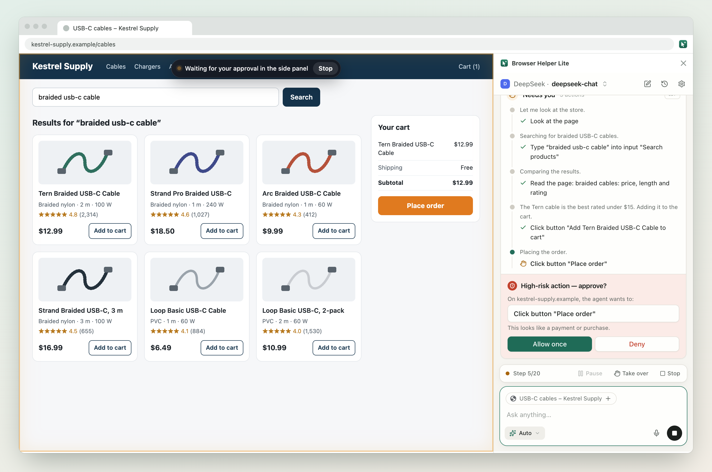
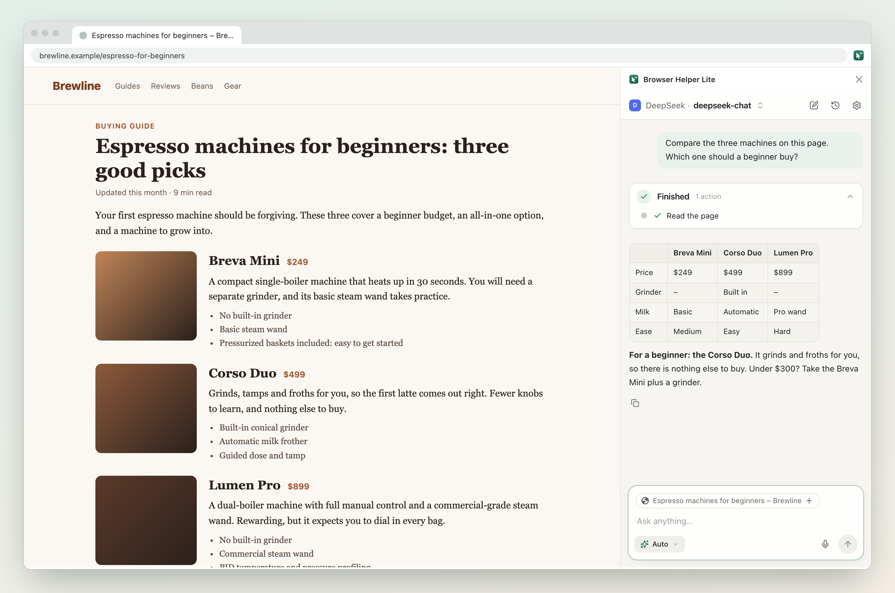
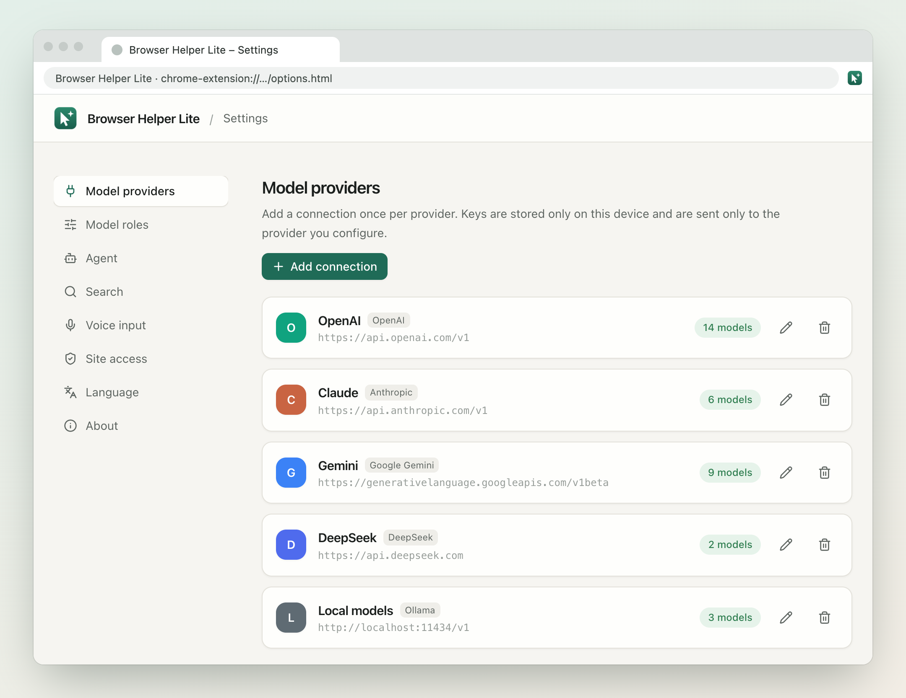

# Browser Helper Lite

[English](README.md) | 简体中文

一个 Chrome 侧边栏 AI 助手，模型和 API Key 都由你自己选。它能回答你在看的网页上的问题，也能在你允许的网站上替你点击、输入、跳转，遇到有风险的操作会先问你。



## 功能

- **任意模型，自带 Key**：OpenAI、Anthropic、Google Gemini、DeepSeek，以及任何 OpenAI 兼容接口（通义千问、Kimi、智谱、豆包、OpenRouter、Groq、Ollama、LM Studio 等）。
- **围绕网页对话**：总结、比较当前页面，用 `@` 带上别的标签页；Markdown 支持代码、公式和 Mermaid 图表；支持语音输入。
- **替你操作网站**：搜索、点击、输入、滚动、开标签页来完成任务；遇到验证码和登录时交给你。
- **始终由你掌控**：三种模式：查询（只读）、自动（付款、删除等高风险操作前会问你）、手动批准（每个改动都要你确认），还可以按网站设规则。随时可以暂停、停止或自己接手。
- **防范提示词注入**：网页里的隐藏文字不会交给模型，网页内容冒充不了指令，会把你的数据带出去的链接需要你批准。详见 [安全文档](docs/security/README.md)。
- **没有自己的服务器**：对话保存在你的浏览器里，请求直接发往你配置的模型供应商。

界面支持简体中文、English、Français、Español。

| 问你正在看的页面 | 接入你用的模型供应商 |
| --- | --- |
|  |  |

## 安装

需要 Chrome 116 或更新版本。

1. 从 [Releases](https://github.com/ethanzhrepo/browser-helper-lite/releases) 下载 `browser-helper-lite-<版本>-chrome.zip` 并解压。
2. 打开 `chrome://extensions`，开启「开发者模式」，点「加载已解压的扩展程序」，选择解压出来的文件夹。
3. 点工具栏图标打开侧边栏，在设置里添加一个模型连接。

助手操作网页时，Chrome 会显示「正在调试此浏览器」的提示条：扩展通过 Chrome 的调试接口发送真实的鼠标和键盘输入。想不授予 `debugger` 权限，可以用 `pnpm build:no-cdp` 构建，助手会改用模拟的页面事件。

## 开发

需要 Node.js 20+ 和 pnpm。

```bash
pnpm install
pnpm dev           # 打开一个已加载扩展的 Chrome
pnpm build         # 构建到 .output/chrome-mv3
pnpm zip           # 打包发布用的 zip
pnpm compile       # 类型检查
pnpm test          # 单元测试
pnpm test:e2e      # 端到端测试：在 Chromium 里对着模拟模型服务器跑
pnpm screenshots   # 重新生成 README 里的截图
```

第一次跑端到端测试前，先用 `pnpm exec playwright install chromium` 安装 Playwright 的浏览器，或者用 `CHROMIUM_PATH` 指定 141 或更新版本的 Chromium。

产品设计见 [docs/product-design.md](docs/product-design.md)，安全审计记录见 [docs/security](docs/security/README.md)。

## 隐私

对话保存在浏览器本地。请求直接从扩展发往你的模型供应商。API Key 只存在扩展自己的存储里，不会暴露给任何网页。发往 OpenAI 的请求设置了 `store: false`。

## 安全

发现漏洞请按 [SECURITY.md](SECURITY.md) 私下报告。

## 许可证

[Apache License 2.0](LICENSE)
